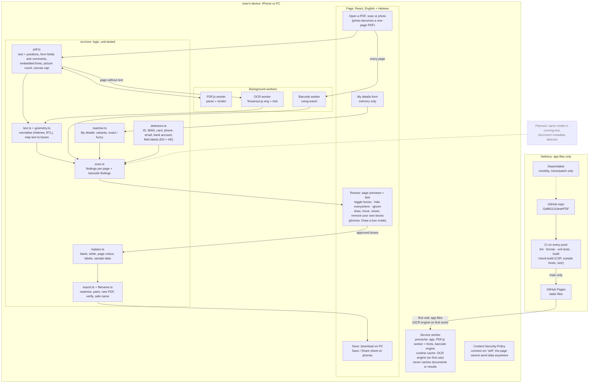
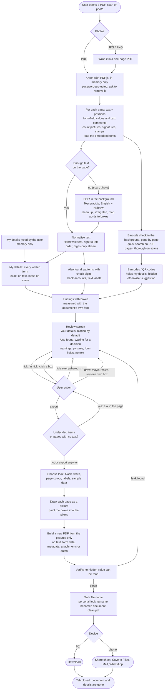

# cleanPDF architecture

How the app is built and how a document is processed. The diagram sources are
[`architecture.mmd`](architecture.mmd) and [`processing-flow.mmd`](processing-flow.mmd);
GitHub draws the copies below. Update both when the code changes.

## Principles

- **The document never leaves the device.** No server, no upload. A
  Content-Security-Policy (`connect-src 'self'`) makes the browser enforce it.
- **Nothing is saved.** The document and "My details" live in memory. The service
  worker caches the app's own files only (and the OCR engine after first use).
- **Hidden means destroyed.** Every page is redrawn as a picture with the boxes
  painted in; the new PDF is built from those pictures only.
- **Heavy work runs in background workers** (PDF.js, OCR, barcodes) so the screen
  stays responsive on a phone.

## Components

## Processing one document

## Where things live

| Part                 | Files                                                                        |
| -------------------- | ---------------------------------------------------------------------------- |
| Screens              | `src/App.tsx`, `src/PageView.tsx`, `src/SaveButton.tsx`, `src/i18n.ts`       |
| Reading PDFs         | `src/core/pdf.ts` (PDF.js), `src/core/ocr.ts` + `ocrItems.ts` (Tesseract.js) |
| Barcodes             | `src/core/barcodes.ts`, `src/core/barcodeWorker.ts` (zxing-wasm)             |
| Finding data         | `src/core/text.ts`, `geometry.ts`, `matcher.ts`, `detectors.ts`, `scan.ts`   |
| Output               | `src/core/replace.ts`, `export.ts`, `filename.ts`, `src/save.ts`             |
| Offline and security | `vite.config.ts` (service worker, CSP), `scripts/check-build.mjs`            |
| Delivery             | `.github/workflows/ci.yml`, `pages.yml`, `.github/dependabot.yml`            |
